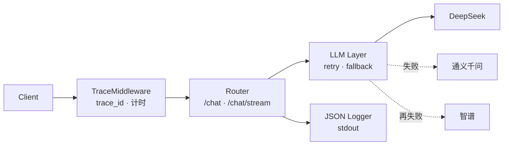

# ai-service-starter

> 一个可直接复用的 LLM 应用后端骨架：多供应商热切换、流式输出、重试与降级、全链路 trace。
> 不是 demo，是后续所有 AI 项目的起点。

写这个仓库的动机很简单：大多数 LLM demo 卡在「notebook 里能跑，服务里跑不动」。
这个骨架把「服务该怎么写」的部分固定下来——模型只是配置项，换供应商不用改代码。

---

## 特性

- **流式输出**：SSE 逐 token 下发，首字延迟低至百毫秒级
- **多供应商**：DeepSeek / 通义 / 智谱开箱即用，加一家只需改 YAML
- **重试**：指数退避，只重试值得重试的错误（5xx / 429 / 超时）
- **降级**：主模型失败自动切备用，响应里标明是否走了降级
- **可观测**：每个请求一个 `trace_id`，结构化 JSON 日志，一行 `grep` 还原全链路
- **可部署**：`docker compose up` 一键起，自带健康检查
- **可测试**：契约测试不依赖真实 API Key，CI 直接跑

---

## 架构



请求进入后先分配 `trace_id`，再交给路由；路由只做协议转换，所有模型交互收敛在 `app/llm/client.py` 一处。
这样加接口、加模型、加重试策略都只动一个文件。

---

## 快速开始

### 方式一：本地

```bash
python -m venv .venv
source .venv/bin/activate          # Windows: .venv\Scripts\activate
pip install -r requirements.txt

cp .env.example .env               # 填入任意一家的 API Key
uvicorn app.main:app --reload
```

打开 http://127.0.0.1:8000/docs 看自动生成的接口文档。

### 方式二：Docker

```bash
cp .env.example .env               # 填入 API Key
docker compose up --build
```

### 方式三：在 IDE 里跑（PyCharm / VS Code）

1. **打开项目根目录** `ai-service-starter`，不是里面的 `app/`
2. 解释器选已有的 `.venv`（PyCharm：`Settings → Project → Python Interpreter → Add → Existing`）
3. 右键 `run.py` → Run（或按 Shift+F10）
4. 浏览器打开 http://127.0.0.1:8000/docs

配置与 `.env` 都按项目根解析，所以工作目录设在哪都不会找不到文件。
`run.py` 带 `reload=True`，改代码会自动重启——只用于本地，生产走 `uvicorn` 命令行。

**调试建议**：在 `app/llm/client.py` 的 `complete()` 和 `_with_retry()` 上打断点，
发一次请求走一遍，比读十遍代码有效。你能直接看到：重试了几次、降级时 `idx` 怎么变、
`_payload()` 最终发出去的 JSON 长什么样。

### 验证

```bash
curl http://127.0.0.1:8000/health
# {"status":"ok","version":"0.1.0","models_available":["deepseek-chat"],"default_model":"deepseek-chat"}
```

---

## 接口

| 方法 | 路径 | 说明 |
|---|---|---|
| GET | `/health` | 存活检查 + 当前可用模型 |
| GET | `/models` | 模型注册表（不返回密钥） |
| POST | `/chat` | 非流式对话，返回完整文本 + token 用量 |
| POST | `/chat/stream` | 流式对话，SSE |

### 非流式

```bash
curl -X POST http://127.0.0.1:8000/chat \
  -H "Content-Type: application/json" \
  -d '{"messages":[{"role":"user","content":"用一句话解释什么是 RAG"}]}'
```

```json
{
  "model": "deepseek-chat",
  "content": "RAG 是先检索相关资料再让模型基于资料回答的方法。",
  "usage": {"prompt_tokens": 29, "completion_tokens": 24, "total_tokens": 53},
  "latency_ms": 842,
  "fallback_used": false
}
```

### 流式

```bash
curl -N -X POST http://127.0.0.1:8000/chat/stream \
  -H "Content-Type: application/json" \
  -d '{"messages":[{"role":"user","content":"用 100 字介绍 RAG"}]}'
```

```
data: {"type": "meta", "model": "deepseek-chat", "fallback_used": false}

data: {"type": "delta", "content": "RAG"}

data: {"type": "delta", "content": " 是"}

data: {"type": "usage", "usage": {"prompt_tokens": 29, "completion_tokens": 96, "total_tokens": 125}}

data: [DONE]
```

事件类型：`meta`（首帧，告知实际使用的模型）、`delta`（增量文本）、`usage`（结束时给）、`error`、`[DONE]`。
用 `meta` 先发一帧，客户端才能知道到底哪个模型在回答——降级发生时这点尤其重要。

---

## 换模型 / 加供应商

全部在 `config/models.yaml` 里，**不需要动代码**。

```yaml
providers:
  moonshot:
    base_url: https://api.moonshot.cn/v1
    api_key_env: MOONSHOT_API_KEY
    timeout: 60

models:
  kimi:
    provider: moonshot
    model: moonshot-v1-8k
    temperature: 0.3
    max_tokens: 2048

fallbacks:
  deepseek-chat: [kimi, qwen-plus]
```

然后在 `.env` 里加上 `MOONSHOT_API_KEY` 即可。请求时传 `{"model": "kimi"}` 切过去。

---

## 设计取舍

这部分是代码里看不到、但决定了能不能上生产的东西。

| 决策点 | 选择 | 原因 |
|---|---|---|
| 重试放在哪 | SDK `max_retries=0`，外层统一重试 | 两处都开会让失败放大成 3×3 = 9 次调用，烧钱且拖长尾延迟 |
| 降级粒度 | 模型级，非 provider 级 | 同一家挂了换它的另一个模型通常也没用，直接换家 |
| 默认模型 | 配置的 `default` 优先，无凭证时退到第一个可用模型 | 只配了一家 key 时，不必每次请求都先撞两个失败再降级 |
| 流式如何降级 | 只在「建流阶段」切换 | 已经吐了字再切，用户会看到两个回答粘在一起 |
| 配置拆分 | 结构进 YAML，密钥进环境变量 | 结构可以放心提交，密钥永远不进仓库 |
| 日志格式 | JSON 单行 + `trace_id` | 无需 ELK 也能 `grep`，后续接 Loki 零改动 |
| 校验位置 | Pydantic 在入口拦 | 脏数据不进业务层，错误信息对调用方友好 |

### 踩坑记录

- **`pydantic-settings` 不会把 `.env` 注入 `os.environ`**。它只把值放进 Settings 对象。
  如果代码里按「环境变量名」动态取配置（比如 `api_key_env: DEEPSEEK_API_KEY` 这种设计），
  必须额外 `load_dotenv()` 一次，否则 `.env` 里的 key 永远读不到——而真实环境变量又能读到，
  症状是「本地怎么填都不生效，上线反而正常」。这个坑很隐蔽，测试也容易漏掉。
- **`stream_options` 不是所有供应商都支持**。传了可能直接 400，所以 `_open_stream` 里做了降级：失败就退回普通流式（代价是拿不到 token 用量）。
- **流式经过 nginx 会被攒成一坨**。必须加 `X-Accel-Buffering: no`，否则本地正常、线上「一次性刷出来」。
- **`asyncio` 里放同步代码等于没并发**。模型调用全程 `await`，任何一步阻塞都会让整个事件循环停住。
- **不要用 `app/logging.py` 这种文件名**。会和标准库 `logging` 冲突，这里叫 `logging_setup.py` 就是为了避开这个坑。

---

## 项目结构

```
.
├── app/
│   ├── main.py            # 入口：中间件、路由挂载、lifespan
│   ├── settings.py        # 环境变量配置
│   ├── schema.py          # 请求/响应模型（Pydantic）
│   ├── registry.py        # 模型注册表：YAML → ModelSpec → client
│   ├── logging_setup.py   # JSON 日志 + trace_id
│   ├── llm/
│   │   └── client.py      # 重试、降级、流式解析（核心）
│   └── api/
│       └── routes.py      # 路由层，只做协议转换
├── config/models.yaml     # 供应商与模型配置
├── tests/test_api.py      # 契约测试，无需真实 Key
├── Dockerfile
└── docker-compose.yml
```

---

## 测试

```bash
pytest -v
```

测试不依赖真实 API Key：缺 Key 时应当返回 503、流式应当正常收尾、模型列表不得泄露密钥。
这些是「服务不崩」的底线，比 happy path 更值得测。

---

## 自己测一组数据（填进简历用）

```bash
# 首字延迟：连续 20 次，看 P50 / P95
for i in $(seq 20); do
  curl -sN -o /dev/null -w "%{time_starttransfer}\n" \
    -X POST http://127.0.0.1:8000/chat/stream \
    -H "Content-Type: application/json" \
    -d '{"messages":[{"role":"user","content":"介绍一下你自己"}]}'
done
```

把结果按大小排序取 P50 / P95，就是简历上那一行数字的来源。

---

## 已知限制

- 无鉴权。生产环境需要加 API Key 或 JWT 中间件。
- 无持久化。对话历史由调用方维护（这是有意的——服务端不存用户数据，合规更简单）。
- 限流未实现，目前依赖供应商侧的 429 + 本地重试兜底。
- 只覆盖 chat 接口。embedding / rerank 各家的接口形状不同，不在「兼容」范围内。

---

## License

MIT
